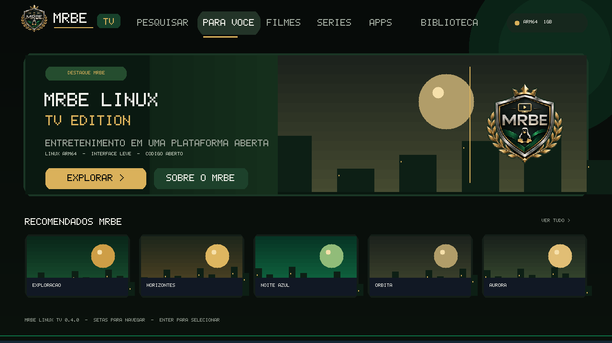
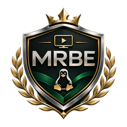

# MRBE Linux TV 0.4.0

[](#estado) [](LICENSE)

Sistema Linux embarcado **experimental** para interfaces de TV em baixo consumo
de recursos. Mantem continuidade do **MRBE Linux DevKit 0.1.0**, construido sobre
Buildroot. Inspirado em navegacao direcional de smart TVs, **nao e Android nem Google TV**.

> Hardware: o nome MXQ Pro abrange plataformas diferentes. Este codigo nao cria
> imagem pronta para gravar no TV Box. A imagem QEMU nao deve ser gravada nele.

## Primeiros passos (Windows 11 / WSL2 Ubuntu)

Abra PowerShell como administrador **uma vez**:

```powershell
wsl --install -d Ubuntu
wsl --update
```

Reinicie o Windows quando solicitado, abra o Ubuntu e crie usuario/senha.
Extraia este ZIP em uma pasta de usuario do Ubuntu (ex.: `~/MRBE-Linux`).
Se baixar no Windows, copie com `cp -r /mnt/c/Users/<USUARIO>/Downloads/MRBE-Linux ~/`;
ou descompacte diretamente no Ubuntu. Evite compilar no `/mnt/c` (lento).

```bash
cd ~/MRBE-Linux
chmod +x scripts/wsl/*.sh scripts/dev/*.sh
make setup
make test             # checagens locais + previa visual
JOBS=2 make build     # primeira compilacao (ou atualizacoes)
make ui-rebuild      # ao atualizar a interface, reconstruir pacote e imagens
make check
make smoke            # exige a imagem compilada; timeout padrao 150 s
make console          # console serial QEMU; Ctrl+A e depois X para sair
make gui              # opcional: janela com launcher (WSLg ativo)
```

### Atualizar da versão 0.2.0 sem perder a compilação

Copie o ZIP para `~/` e execute `unzip -o MRBE_Linux_0_4_0.zip -d ~`; depois `make test && JOBS=2 make ui-rebuild && make smoke && make gui`. **Não remova `work/`**. Leia [o guia de atualização](docs/21-IDENTIDADE-VISUAL-0.4.md).

### Estado
O repositorio inclui **fontes**, scripts e testes. Nao inclui firmware nem
uma imagem Linux compilada. Consulte [STATUS.md](STATUS.md).

### Documentacao por fase
- [Guia iniciante](docs/12-GUIA-INICIANTE-0.2.md)
- [Arquitetura do boot](docs/13-BOOT-QEMU-E-HARDWARE.md)
- [Teste e aceite](docs/14-TESTES-E-EVIDENCIAS.md)
- [Otimizacao 1 GiB](docs/15-OTIMIZACAO-TANENBAUM.md)
- [Hardware MXQ Pro](docs/16-IDENTIFICACAO-MXQ-PRO.md)
- [Publicar no GitHub](docs/17-PUBLICAR-GITHUB.md)
- [Interface TV 0.4.0 e identidade visual](docs/21-IDENTIDADE-VISUAL-0.4.md)
- [Proximos marcos](docs/18-ROADMAP.md)
- [Seguranca e limites](docs/19-SEGURANCA-E-LICENCAS.md)





## Comandos
`make help` | `make test` | `make preview` | `make build` | `make check` |
`make smoke` | `make console` | `make gui` | `make ui-rebuild`.

## Contribuicao
Abra issue ou pull request com logs reproduziveis; leia [CONTRIBUTING.md](CONTRIBUTING.md).

## Licencas
Codigo original do launcher: MIT. O **conjunto do projeto** usa diversos pacotes
com licencas proprias (kernel Linux GPL-2.0-only, BusyBox GPL-2.0-only,
Buildroot GPL-2.0-or-later); siga os requisitos de distribuicao de cada pacote.
Nao redistribuir codigos proprietarios nem marcas ou logos de Google/Netflix.
